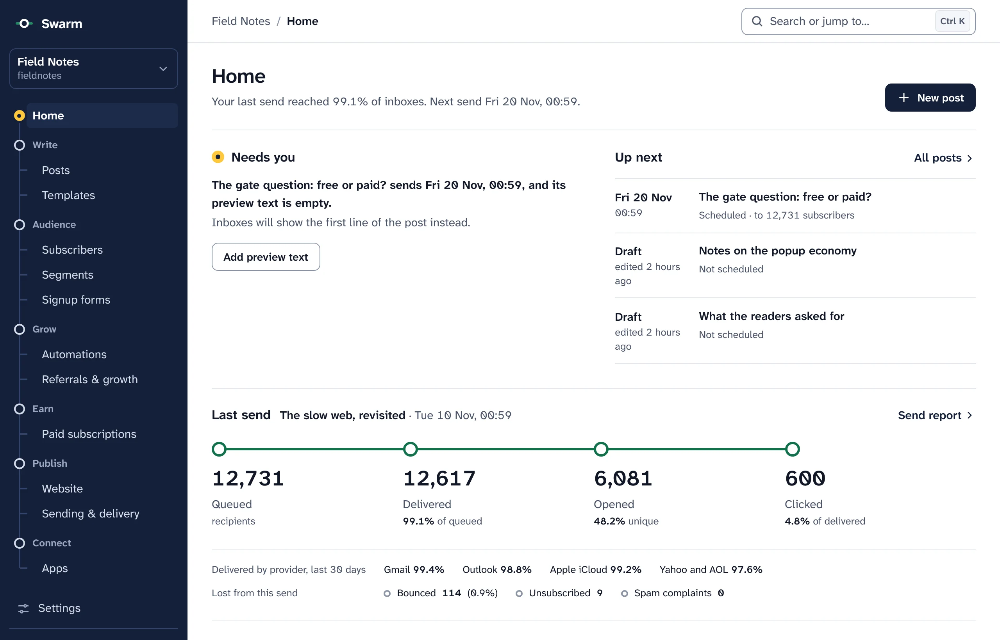
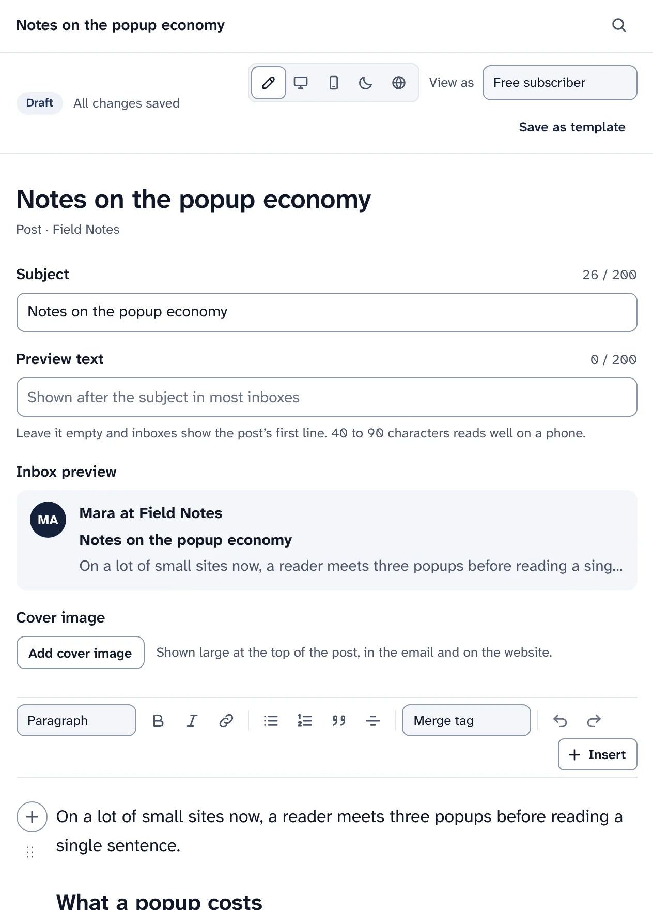
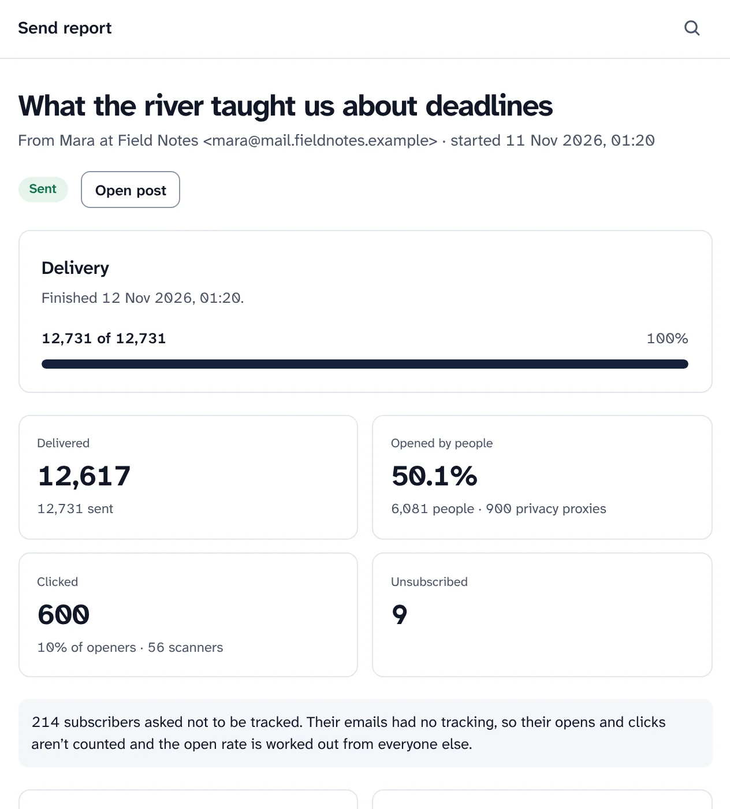
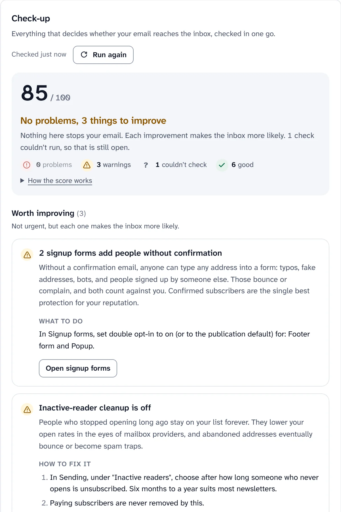
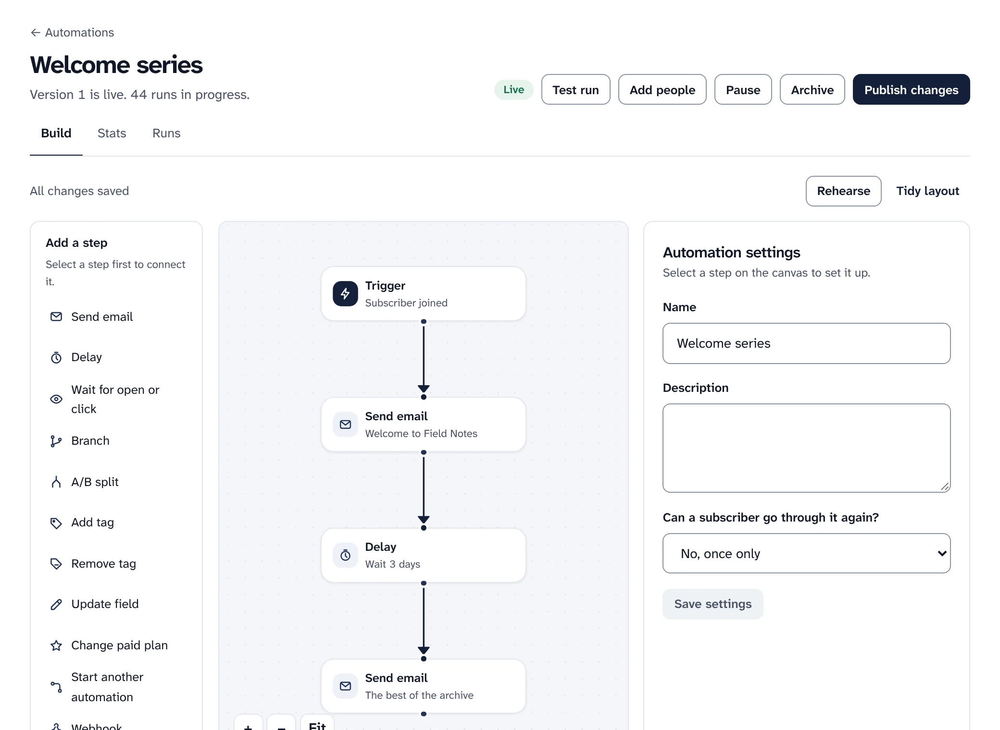
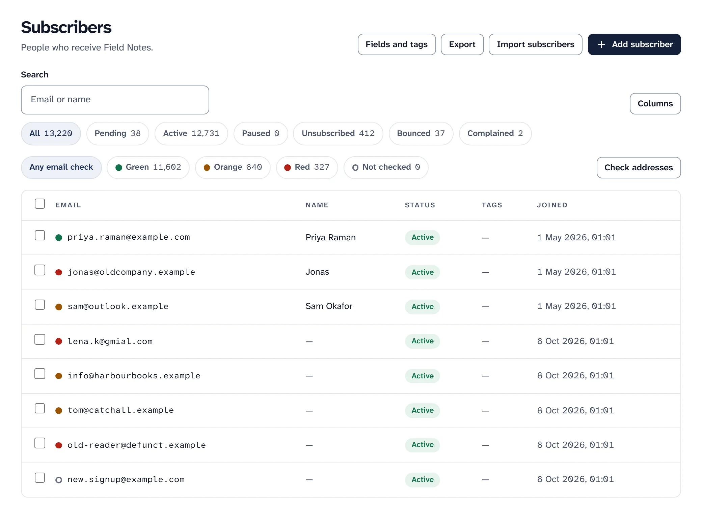

# Swarm

[](LICENSE)
[](CHANGELOG.md)
[](https://workers.cloudflare.com/)
[](package.json)

**Your whole newsletter on your own Cloudflare account: the editor, the sending, the website and the paid subscriptions.**

Write a post, send it to your list, publish it on your own domain and let readers pay for it. Your subscribers live in a database on your account, your email goes out through the service you pick, and Swarm takes 0% of what readers pay you. Stripe's own fees are the only ones on a payment.

[**Install it**](#install) · [**Try it on your computer first**](#try-it-on-your-computer) · [Learn more at swarm.jantegze.com](https://swarm.jantegze.com/)

> [!WARNING]
> **Pre-release, version 0.0.1.** Swarm is published so people can try it, not yet for a newsletter you depend on. I'm testing it on real accounts and fixing bugs as I find them, so expect rough edges and changes between versions.
>
> **Testers and ideas are welcome.** If you install it, [send an install report](https://github.com/jntegz/newsletter-swarm/issues/new?template=install_report.yml), [report a bug](https://github.com/jntegz/newsletter-swarm/issues/new?template=bug_report.yml) or [suggest a feature](https://github.com/jntegz/newsletter-swarm/issues/new?template=feature_request.yml). Pull requests with fixes are welcome too; see [Contributing](#contributing).



[Why Swarm](#why-swarm) · [Screenshots](#screenshots) · [Features](#what-you-get) · [Install](#install) · [Costs](#what-it-costs) · [Documentation](#documentation) · [What is tested](#what-is-tested-and-what-is-not) · [Contributing](#contributing)

## Why Swarm

|                           | A typical hosted newsletter platform                    | Swarm                                                                                                              |
| ------------------------- | ------------------------------------------------------- | ------------------------------------------------------------------------------------------------------------------ |
| Fee on paid subscriptions | Often a share of every payment, on top of payment fees  | 0%. Readers pay you through Stripe, and only Stripe's fees apply                                                   |
| What you pay              | A monthly plan, usually priced by the size of your list | Your Cloudflare plan and your email service, priced by what you use                                                |
| Where your list lives     | On the platform's servers                               | In a D1 database on your own Cloudflare account                                                                    |
| Code                      | Usually closed                                          | Open source under AGPL-3.0                                                                                         |
| Your data                 | Usually a CSV of subscribers                            | The whole database is on your account. Export subscribers any time, or copy them to your own storage on a schedule |
| Deliverability            | Varies, often with little you can inspect or change     | Your own sending domain, a check-up that names each problem and its fix, and warm-up for new domains               |

Hosted platforms differ. This compares Swarm with the usual arrangement, not with any one service.

## Screenshots

|                                                                                                                                                        |                                                                                                                                                  |
| ------------------------------------------------------------------------------------------------------------------------------------------------------ | ------------------------------------------------------------------------------------------------------------------------------------------------ |
|  |                 |
| **Write.** A block editor with an inbox preview, previews for desktop, phone and dark mode, and a "view as" switch for free and paid readers.          | **Send.** A live report while the send runs, with opens from privacy proxies and clicks from link scanners counted apart from people.            |
|             |  |
| **Reach the inbox.** A check-up scores everything that decides delivery and says how to fix each item.                                                 | **Grow.** Automations with a visual builder and ready-made recipes such as a welcome series and a win-back.                                      |
|                                       |                     |
| **Keep the list clean.** Optional address checks with DeBounce mark every subscriber green, orange or red.                                             | **Earn.** Paid plans, trials, coupons and gifts through Stripe, with a revenue dashboard.                                                        |


**Publish.** Every publication gets a website on your own domain, with five templates, an archive, search and RSS.

## What you get

- **Writing.** A block editor with images, buttons, quotes, code, embeds, polls, a paywall break and reusable snippets. Starter templates, your own saved templates, a content calendar and a writing assistant you can turn on.
- **Sending.** Send now, schedule, or send at each reader's best time. Split tests, segments, several lists per publication, resend to people who didn't open, a live send report, tracked links and a click map.
- **Deliverability.** Your own sending domain with DKIM, SPF and DMARC checked for you. A check-up that says what is hurting delivery and how to fix it, sending limits that match your email service's plan with nothing lost when a limit is reached, a content check before each send, automatic warm-up for new domains with a day-by-day plan, bounce and complaint handling, DMARC reports and one-click unsubscribe.
- **A website for each publication.** Five templates, an archive, post pages, sections, custom and landing pages, search, RSS, your own domain, and no third-party scripts unless you add them.
- **Audience.** Import and export, custom fields and tags, segments, signup forms with confirm opt-in, a page where subscribers manage their own settings, cleanup of inactive readers, bounce rules you choose, and address checks with [DeBounce](docs/email-verification.md) at signup, on import and across your list.
- **Growth.** Automations with a visual builder and ready-made recipes (welcome email, welcome series, win-back and more), referrals with rewards, polls and surveys, signup journeys and a link-in-bio page.
- **Paid subscriptions.** Stripe (and PayPal as a preview) with 0% taken by Swarm: paid plans, trials, coupons, gift subscriptions, pay what you want and a revenue dashboard.
- **For teams and developers.** Roles, an audit log, passkeys and two-step sign-in, a public API with an OpenAPI document and a TypeScript SDK, signed webhooks, an MCP server for AI tools and a WordPress plugin.
- **Privacy.** Subscriber export and erasure, consent records, optional encryption of sensitive fields, cookieless website analytics.

It runs on Cloudflare (Workers, D1, R2, KV, Queues, Durable Objects). Email goes out through a service you choose: Resend, Amazon SES, Mailgun, Postmark or your own mail server.

## Install

There are three ways in. Pick by what you want to do today.

| You want to                              | Use                                                                | Needs                                                    | Status                                         |
| ---------------------------------------- | ------------------------------------------------------------------ | -------------------------------------------------------- | ---------------------------------------------- |
| Look around the dashboard and test it    | [Run it on your computer](#try-it-on-your-computer)                | Node.js 22, pnpm 10 and git. No accounts                 | Available                                      |
| Run a real newsletter on your own domain | [The installer, `pnpm swarm`](#install-on-your-cloudflare-account) | A Cloudflare account with a domain, and an email service | Available, still being tested on real accounts |
| Install without a terminal               | [The browser setup page](#install-without-a-terminal)              | A Cloudflare account with a domain, and an email service | Waiting for the first signed release           |

### Try it on your computer

The whole product runs locally, on Cloudflare's local runtimes, with no Cloudflare account and no email service. This is the quickest way to see what Swarm does and to test a fix.

```bash
git clone https://github.com/jntegz/newsletter-swarm.git swarm && cd swarm
pnpm install
pnpm setup:dev   # writes each worker's local settings and creates the local database
pnpm dev         # every worker plus the dashboard on http://localhost:5273
```

Open http://localhost:5273 and ask for a sign-in link. No email leaves your computer: the link lands in a dev mailbox at http://localhost:5273/__dev/mail.

### Install on your Cloudflare account

You need:

- a Cloudflare account with a domain on it, on a plan that includes Queues and Durable Objects (the Workers Paid plan does);
- Node.js 22 or newer, pnpm 10 (`corepack enable`) and git;
- an account with an email service. Resend is the quickest to start with.

```bash
git clone https://github.com/jntegz/newsletter-swarm.git swarm && cd swarm
pnpm install
pnpm swarm --dry-run   # optional: shows every step and changes nothing
pnpm swarm
```

The installer asks for your domain, your name and email, the name of your first publication and how to send email. It then creates the database, storage, queues and DNS records on your account, deploys everything and prints a one-time sign-in link. Your main domain's website and its email are left alone: Swarm adds subdomains such as `app.`, `forms.` and `mail.`. If the installer stops for any reason, run it again: finished steps are skipped.

After you sign in, follow [Getting started](docs/getting-started.md): it takes you from an empty dashboard to your first post in subscribers' inboxes.

|                         |                                                                        |
| ----------------------- | ---------------------------------------------------------------------- |
| Check an install        | `pnpm swarm doctor`                                                    |
| Update to a new version | `pnpm swarm update`                                                    |
| Lost your sign-in       | `pnpm swarm signin-link`                                               |
| Turn things on later    | `pnpm swarm enable custom-domains`, `enable payments`, `enable google` |
| Change email service    | `pnpm swarm mail switch <service>`                                     |

**Back up the `.swarm/` folder** the installer creates. It holds the keys for your install and is not in git. Without it you can't update the install.

The full guide, with what the installer creates, how to choose an email service, backups, staging and removal, is [docs/self-hosting.md](docs/self-hosting.md). If something goes wrong, see the [FAQ](docs/faq.md#installing), and please [tell me in an install report](https://github.com/jntegz/newsletter-swarm/issues/new?template=install_report.yml).

### Install without a terminal

The browser setup page ([guide](docs/setup-guide.md)) is a small Worker you deploy to your account. It asks for a Cloudflare token and your email service key, shows exactly which release it is about to install, and installs it for you. It is built and tested, but it installs only signed releases, and the first one isn't out yet. A **Deploy to Cloudflare** button will appear here with that release. Until then, use the installer above.

### What it costs

Swarm is free and takes no share of what your readers pay you. You pay the services it runs on, directly:

- **Cloudflare:** a plan that includes Queues and Durable Objects (Workers Paid), plus any usage beyond what the plan includes. See [Cloudflare's pricing](https://developers.cloudflare.com/workers/platform/pricing/).
- **A domain** on Cloudflare.
- **An email service**, usually the main cost as your list grows. Resend has a free plan of 100 emails a day and 3,000 a month; Amazon SES charges per email, about $0.10 per 1,000.
- **Stripe**, if you sell subscriptions, charges its own fees on each payment.

Prices change, so check each service. More in the [FAQ](docs/faq.md#costs).

## Documentation

Start at [docs/README.md](docs/README.md) for the full list. The most used pages:

| If you want to                              | Read                                                 |
| ------------------------------------------- | ---------------------------------------------------- |
| Install, update, back up or remove Swarm    | [Self-hosting](docs/self-hosting.md)                 |
| Go from a new install to a first send       | [Getting started](docs/getting-started.md)           |
| Write, test, schedule and send              | [Writing and sending](docs/writing-and-sending.md)   |
| Add a sending domain or a website domain    | [Domains](docs/domains.md)                           |
| Understand why a new domain sends gradually | [Warm-up](docs/warm-up.md)                           |
| Find out why email isn't arriving           | [Deliverability guide](docs/deliverability-guide.md) |
| Import subscribers and build signup forms   | [Audience](docs/audience.md)                         |
| Choose and adjust email templates           | [Templates](docs/templates.md)                       |
| Set up the publication's website            | [Website](docs/website.md)                           |
| Fix a problem                               | [FAQ and troubleshooting](docs/faq.md)               |
| Build on Swarm                              | [API](docs/api.md), [Webhooks](docs/webhooks.md)     |

## What is tested and what is not

Swarm is honest about this so you can decide where to be careful.

- **Tested automatically on every change:** the whole product against local Cloudflare runtimes (unit and integration tests for every worker, and browser tests of the dashboard and reader pages), with the email service, Stripe and Cloudflare's API replaced by stand-ins.
- **Not yet run against real accounts:** the installer beyond `--dry-run`; the browser setup page; Mailgun, Postmark and your own mail server; Amazon SES setup on the browser page; changing email service; PayPal; Stripe with a publication's own key; single sign-on (off at install). Each is marked as a preview where you choose it. The same goes for the security changes of November 2026: the `swarm-vault` worker and the calls to it, per-link keys and their rotation, and updating an older install to them have run only on local runtimes.
- **Not yet proven at volume:** large sends and a 50,000-subscriber import have load scripts ([docs/load-testing.md](docs/load-testing.md)) but no production record, and nobody has yet measured how mailbox providers treat mail from a real install.

If you install it, please [send an install report](https://github.com/jntegz/newsletter-swarm/issues/new?template=install_report.yml) with what worked and what didn't. That is the fastest way for these lists to shrink.

## Local development

Start the workers and the dashboard as in [Try it on your computer](#try-it-on-your-computer). Local email is never sent; it lands in the dev mailbox at `http://localhost:5273/__dev/mail`.

| Service   | Local port |
| --------- | ---------- |
| dashboard | 5273       |
| api       | 8787       |
| send      | 8788       |
| events    | 8789       |
| track     | 8790       |
| capture   | 8791       |
| site      | 8792       |
| jobs      | 8793       |
| realtime  | 8796       |

Checks:

```bash
pnpm lint && pnpm typecheck && pnpm test   # unit and worker integration tests
pnpm test:e2e                              # Playwright against local workers and the dashboard
pnpm check:vocabulary                      # product words in UI copy and docs
pnpm check:dead-code                       # no export that nothing uses (ts-prune, confirmed by tsc)
pnpm openapi                               # regenerate docs/openapi.json
```

### A note on names

The dashboard uses plain words: posts, subscribers, publications, segments, automations. The code, database and API use older internal names for the same things: Dispatch, Member, Channel, Circle, Flow. [docs/vocabulary.md](docs/vocabulary.md) has the full table; you will need it when reading the code or the API.

### Repo layout

```
apps/
  dashboard/     the dashboard: a React app (Vite, Tailwind 4)
  setup/         the browser setup page
  e2e/           Playwright suites
workers/
  api/           dashboard API (/api/v1), public API (/v2), OpenAPI source of truth
  send/          fans a send out to recipients and hands mail to the email service
  events/        delivery, bounce and complaint events; DMARC reports; unsubscribe by email
  track/         tracked links, opens and unsubscribe pages
  capture/       signup forms, confirm opt-in, subscriber settings
  site/          publication websites: pages, feeds, paywall, reader sign-in
  jobs/          imports, exports, segments, automations, webhooks
  realtime/      Durable Objects: live send reports, rate limits
packages/
  domain/        zod schemas, ids, error codes, vocabulary
  engine/        sending, warm-up, deliverability, automations, payments
  mail/          email rendering and the email service adapters
  runtime/       shared worker baseline: env validation, logging, errors, headers
  tokens/        purpose-scoped, expiring, rotatable HMAC tokens
  flags/         feature-flag registry and evaluator
  db/            D1 helpers and the tenancy check
  ui/            shared components and the Tailwind theme
  sdk/           TypeScript client generated from the /v2 OpenAPI document
  installer/     pnpm swarm: installs, checks and updates a self-hosted Swarm
integrations/    the WordPress plugin
migrations/      D1 SQL, forward-only
docs/            user guides, operator guides and developer reference
```

## Contributing

Swarm is in pre-release, so this is the most useful time to help. Bug reports, install reports, feature ideas and pull requests are all welcome: [open an issue](https://github.com/jntegz/newsletter-swarm/issues/new/choose) or send a pull request, and I'll review it. Read [CONTRIBUTING.md](CONTRIBUTING.md) first, and the [code of conduct](CODE_OF_CONDUCT.md). Report security problems privately, as [SECURITY.md](SECURITY.md) describes.

## License

AGPL-3.0. See [LICENSE](LICENSE). If you run a changed version of Swarm as a service for other people, the licence requires you to offer them your source.

---

Created by [Jan Tegze](https://github.com/jntegz).
